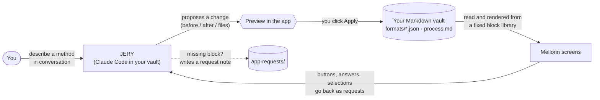
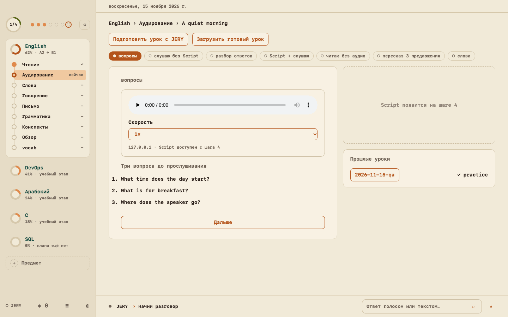
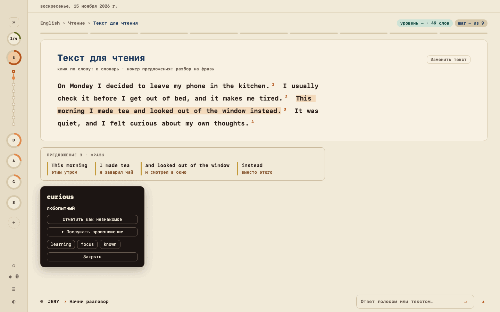
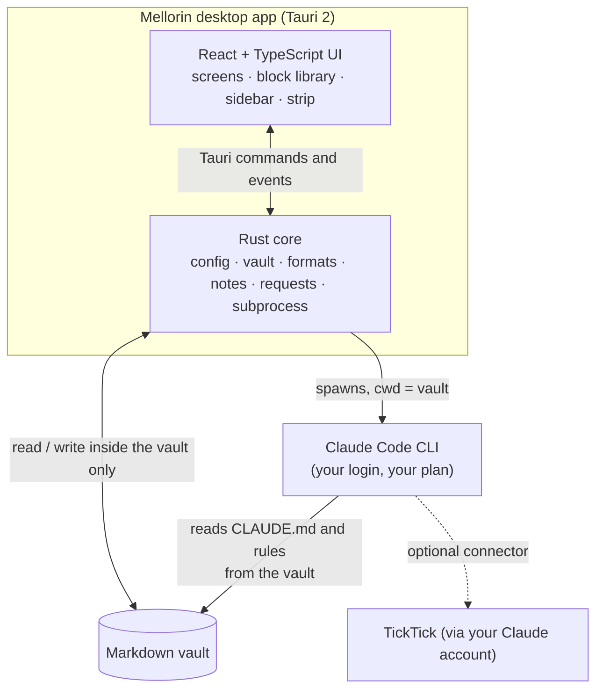

<div align="center">


# Mellorin

**A study workspace whose interface is authored together with an AI agent.**<br>
You describe how you want to learn; the agent writes it into your own Markdown vault; the app draws it.

[](https://github.com/Uzalov-Gamid/Mellorin/actions/workflows/ci.yml)
[](CHANGELOG.md)
[](#requirements)
[](https://tauri.app)
[](LICENSE)

[Русская версия](README.ru.md) · [Documentation](docs/README.md) · [User guide](docs/GUIDE.md) · [Changelog](CHANGELOG.md) · [Design previews](docs/DESIGN.md)


</div>

---

## Contents

1. [Why Mellorin](#why-mellorin)
2. [The idea in one minute](#the-idea-in-one-minute)
3. [A tour of the app](#a-tour-of-the-app)
4. [How it works](#how-it-works)
5. [Requirements](#requirements)
6. [Quickstart](#quickstart)
7. [Configuration](#configuration)
8. [Privacy and safety model](#privacy-and-safety-model)
9. [Keyboard shortcuts](#keyboard-shortcuts)
10. [Status and roadmap](#status-and-roadmap)
11. [FAQ](#faq)
12. [Documentation map](#documentation-map)
13. [License](#license)

---

## Why Mellorin

Studying with an AI assistant in a terminal works, but the terminal is a poor surface for learning. A reading text is a wall of characters; a vocabulary quiz is typed answers like "1b, 2g"; progress lives in files you have to open; and every new study method means asking the assistant to behave differently, over and over.

Mellorin keeps what is good about that workflow (a capable agent, your own notes, no lock-in) and replaces the terminal with an interface that is **designed for studying** and that **the agent itself can reshape**:

- **Your data stays yours.** Everything lives in a local folder of Markdown files, the same folder Obsidian opens. Delete the app and nothing is lost.
- **The agent does the content work.** It creates subjects, writes lessons, adds words, keeps notes and plans. The app does not author content.
- **The app does the visual work.** Clickable words and sentences, numbered text, buttons instead of typed answers, hidden transcripts that open at the right step, a progress trail, a notes reader.
- **New methods do not need new code.** Say "put a number after every sentence" and the agent changes a lesson format; the app renders it.

## The idea in one minute

Most software ships a fixed interface. Mellorin ships a **small, strict language for interfaces**, and lets an agent write in it on your behalf.



Four rules keep this safe and predictable:

1. **Formats are data, not code.** A lesson format is a JSON file in your vault: steps, and for each step a list of blocks. No HTML, no scripts, no expressions. The renderer never evaluates anything.
2. **A fixed block library, in three levels.** Level 1 primitives (heading, text, list, table, card, columns, progress, quote, code), level 2 smart blocks (clickable-word text, sentence numbering, quiz, flashcards, audio player, code/query field, timer, checklist, collapsible answers), and level 3: a *request* when the block you need does not exist yet.
3. **Style is enforced by the app, not requested by the agent.** The agent describes meaning ("this is a warning"), never hex colors or pixel sizes. Everything it builds looks native.
4. **Nothing changes without your click.** A change proposed by the agent is shown as a preview with the exact file changes; applying it is your decision, it is versioned in `formats/.history/`, and it can be rolled back.

The result is an interface that grows with how you actually study, without you or the agent writing application code.

## A tour of the app

All screenshots below are real renders of the application on a **synthetic vault** (invented data), produced by `scripts/visual-qa.mjs`.

| | |
|---|---|
|  **Reading.** Numbered sentences, click a sentence to split it into phrases, click a word for translation, pronunciation and a vocabulary status. |  **Words.** A lesson of ten words with buttons instead of typed answers, progress dots and a step tracker. |
|  **Listening.** Questions before the audio, the script stays hidden until the step where you need it. |  **Writing.** Your text with marked errors, a review card per sentence, then a rewrite. |
|  **Grammar.** Theory in parts, forms in a table, practice, homework tracking. |  **Notes reader.** Your real notes, rendered like Obsidian: properties, headings, tables, callouts, wikilinks, outline. |
|  **Collapsed sidebar.** The trail folds to rings with a mini trail under the active subject (⌘B). |  **Settings.** Vault, Claude Code, what the agent may do, TickTick access, workshop history with rollback. |

### The sidebar: a trail, not a tree

At the top: a **day ring** (tasks done today) and **week dots**. Below, the open subject is a card with a progress ring and a **trail** of its skills: passed nodes filled, the current one ringed, the rest empty, the line orange up to the last passed step. Other subjects fold into one-line rows. There is no application name or title text at the top: the space is used for state, not labels.

### The strip: one line for your agent

The bottom strip is always visible: the agent's last message in one line and an input that works with macOS dictation. Expand it (⌘J) to see the whole conversation. When the agent is thinking, rate-limited or interrupted, the strip says so and offers a retry.

## How it works



- **The agent is Claude Code, started in your vault.** Mellorin makes no model API calls and holds no API key. The agent loads *your* `CLAUDE.md` and rules, so its personality and methods live in your files, not in the app.
- **The app talks to the agent through the CLI's streaming JSON** and shows replies incrementally. A reply may contain fenced `mellorin` blocks (a quiz, a table, a card set): the app removes the raw JSON from the chat and renders the blocks.
- **Lesson formats** are `formats/<subject>-<skill>.json`. A format change goes through a `mellorin-change` proposal, a preview, an explicit Apply, an atomic write and a version snapshot. See [formats](docs/formats.md) and the [reply protocol](docs/jery-protocol.md).
- **State for the dashboard** (`.mellorin/state.json`, `today.json`) is written by the agent from your real files; the app only reads and shows it. No numbers are invented.
- **TickTick** (tasks and calendar) is reached through the connector in your Claude account, never through credentials stored in Mellorin.

## Requirements

- **macOS** on Apple Silicon (developed and verified there). The code is cross-platform Tauri; Windows and Linux are not verified in this release.
- **[Claude Code CLI](https://www.anthropic.com/claude-code)** installed and signed in. Mellorin uses your existing subscription through the CLI.
- *(Optional)* the **TickTick connector** enabled in your Claude account, for today's tasks and calendar.
- A folder of **Markdown files** to act as the vault: an Obsidian vault works as is. Start with a *copy* while you evaluate.
- To build from source: Node.js 20+, stable Rust, and the [Tauri 2 prerequisites](https://tauri.app/start/prerequisites/).

## Quickstart

The source is public for reading; running it requires the author's permission (see [License](#license)). With permission:

```bash
git clone https://github.com/Uzalov-Gamid/Mellorin.git
cd Mellorin
npm ci

# development window with hot reload
npm run tauri -- dev

# or a release build: the app and a .dmg appear in src-tauri/target/release/bundle/
npm run tauri -- build
```

**First run**

1. Open Mellorin and press <kbd>⌘</kbd><kbd>,</kbd> to open Settings.
2. Set the **vault path** to your Markdown folder (a copy is wise for the first days) and check the **Claude Code** path.
3. Decide whether the agent may edit files in the vault (**on** by default) and its **TickTick** access: *read and write*, *read only*, or *off*.
4. Go to a subject in the sidebar and talk to the agent in the bottom strip: *"let's read a text"*, *"start the words lesson"*, *"what is on today?"*.

**Keep your data safe.** Use the helper scripts in [`scripts/`](scripts/README.md): `vault-backup.sh` (verified snapshot), `vault-diff.sh` (read-only comparison with the original), `vault-history.sh` (look at and undo changes in a vault that is a git repository).

## Configuration

Settings are stored in `mellorin.toml` in the application support folder (`~/Library/Application Support/dev.mellorin.app/` on macOS) and edited in the Settings screen.

| Key | Default | Meaning |
|---|---|---|
| `vault_path` | `~/MellorinVault` | The folder the agent runs in and the app reads |
| `claude_path` | `claude` | Path to the Claude Code CLI |
| `theme` | `light` | Visual theme (light cream palette; dark is planned) |
| `text_size` | `14` | Base text size |
| `jery_can_edit_vault` | `true` | Allow the agent to create and edit files **inside the vault** |
| `jery_ticktick` | `full` | `full` (read and write), `read`, or `off` |

Full reference: [docs/CONFIGURATION.md](docs/CONFIGURATION.md).

## Privacy and safety model

- **Local first.** The vault, the app state and the formats are plain files on your computer. Content goes only to the Claude Code subprocess you started, under your own account.
- **No keys in the app.** Mellorin stores no API keys or credentials.
- **Edits stay in the vault.** With `jery_can_edit_vault`, the CLI runs in `acceptEdits` mode: file changes inside the vault are approved; **commands, network access and writes outside the vault remain denied**. Permission bypass modes are never used.
- **Formats are inert.** They are validated data with strict limits (256 KiB, depth 8, bounded sizes). They cannot contain code or write paths.
- **You approve changes.** A proposed format change is previewed and applied only by your click, with a recoverable history.
- **Service files are left alone.** The app never moves or edits your `CLAUDE.md` files, `.claude/`, `.obsidian/`, `JERY/` or `Templates/`; it adds only `.mellorin/` and `formats/`.

Details: [SECURITY.md](SECURITY.md) and [vault permissions](docs/vault-permissions.md).

## Keyboard shortcuts

| Shortcut | Action |
|---|---|
| <kbd>⌘</kbd><kbd>B</kbd> | Collapse or expand the sidebar |
| <kbd>⌘</kbd><kbd>J</kbd> | Expand or collapse the conversation above the strip |
| <kbd>⌘</kbd><kbd>,</kbd> | Open or close Settings |
| <kbd>↵</kbd> | Send to the agent |
| <kbd>a</kbd> <kbd>b</kbd> <kbd>c</kbd> <kbd>d</kbd> (Words) | Choose an answer; <kbd>↵</kbd> continues |

## Status and roadmap

**Version 0.2.0 is a working vertical slice**, built and checked on macOS (Apple Silicon): CI runs Rust formatting, Clippy with warnings denied, Rust tests and the frontend type check and tests (116 frontend tests at this release). The build is **unsigned and not notarized**.

**Implemented**

- Shell: window without a title bar, sidebar trail (collapsible), day ring and week dots, the agent strip with its states.
- Screens: Home, English Reading, Words, Listening, Writing, Grammar, Notes reader, Settings (with the workshop history and rollback).
- The format and block system, the `mellorin` reply protocol, `mellorin-change` proposals with preview, apply and rollback, and the block-requests inbox.
- Vault state files read from your real notes, TickTick through your Claude account, vault-edit permission with a toggle.
- Helper scripts for backup, comparison and history.

**Designed, previews available, not yet built** (see [Design previews](docs/DESIGN.md)): DevOps, Arabic, C and SQL study screens; vocabulary manager; subjects management with archive and restore; new-text dialog; external source panes (pronunciation and listening sites beside the lesson); first-run onboarding; error and limit states; lesson recap; activity calendar; the workshop as a screen of its own.

**Planned:** a dark theme, Windows and Linux verification, signed and notarized builds.

## FAQ

**Does Mellorin send my notes to a server?**
Only to the Claude Code process you run, which talks to Anthropic under your own account. Mellorin itself has no server and no analytics.

**Do I need to use Obsidian?**
No. The vault is a folder of Markdown files. Obsidian is convenient for editing the same files, but it is not required.

**Can I try it without risking my notes?**
Yes, and you should: copy the vault, point Mellorin at the copy, and use `scripts/vault-history.sh` to undo any change. Your original is never touched.

**What if the agent wants a screen element Mellorin does not have?**
It writes a short request note into `app-requests/`. The app shows a badge with the number of open requests. A new block is then added to the application.

**Why a custom language of blocks instead of letting the agent write interface code?**
Because generated code can do anything, and generated *data* can only describe. Restricting the agent to a vetted vocabulary makes every change previewable, reversible and safe to apply on a click.

**Can I use my own agent or model?**
Not in this release. The integration point is the Claude Code CLI; other agents are a possible future direction.

More in [docs/FAQ.md](docs/FAQ.md).

## Documentation map

| If you want to… | Read |
|---|---|
| Use the app step by step | [User guide](docs/GUIDE.md) |
| Look up a setting, a file or a schema | [Configuration](docs/CONFIGURATION.md) · [Formats](docs/formats.md) · [Reply protocol](docs/jery-protocol.md) · [State schema](docs/state.schema.json) |
| Understand the design | [Architecture](docs/architecture.md) · [Design previews](docs/DESIGN.md) · [Glossary](docs/GLOSSARY.md) |
| Know what the agent may do | [Vault permissions](docs/vault-permissions.md) · [SECURITY.md](SECURITY.md) |
| Protect your vault | [scripts/](scripts/README.md) |
| See what changed | [CHANGELOG](CHANGELOG.md) |

The documentation index is [docs/README.md](docs/README.md).

## License

**All rights reserved.** The source is publicly readable on GitHub; using, running, copying, modifying or redistributing it requires prior written permission from [Gamid Uzalov](https://github.com/Uzalov-Gamid). This is not an open-source license. Earlier versions published under the MIT License (tags `mvp` and `v0.1.0`) remain available under that license. See [LICENSE](LICENSE), [docs/LICENSING.md](docs/LICENSING.md) and [THIRD-PARTY-NOTICES](THIRD-PARTY-NOTICES).
