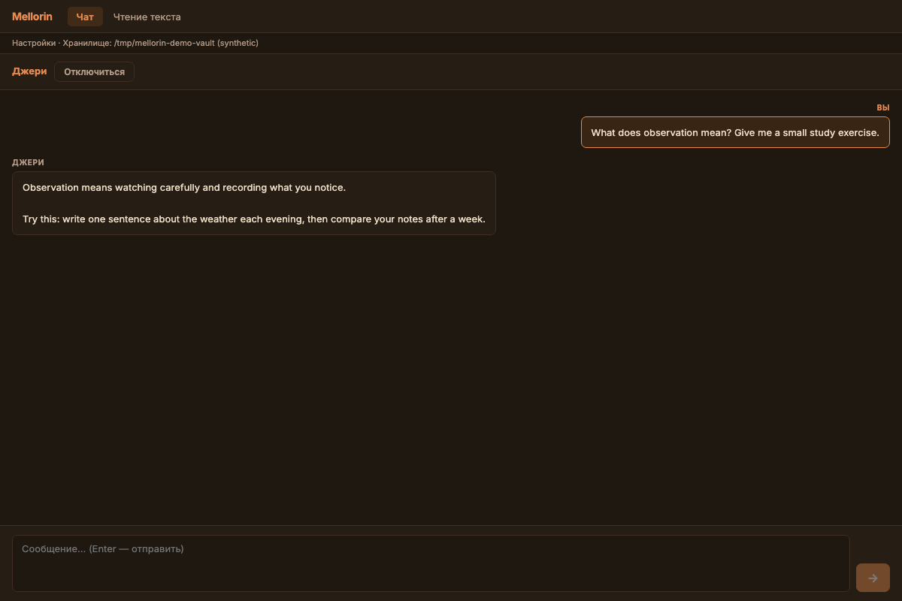
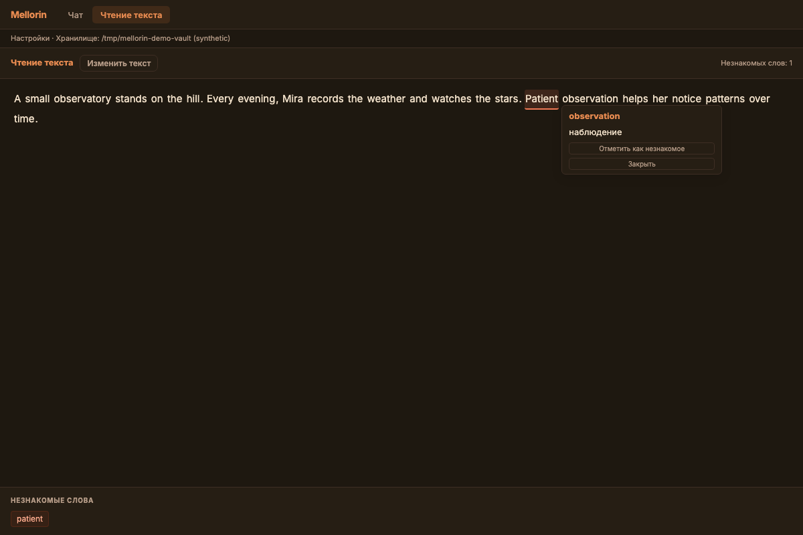

# Mellorin

[](https://github.com/Uzalov-Gamid/Mellorin/actions/workflows/ci.yml)
[](LICENSE)


Mellorin is a desktop study companion built with Tauri, React and Rust. It brings a chat interface and an English reading workspace together around a local Markdown vault. Claude Code CLI is the technical dependency that handles chat and contextual translation.

## What works today

- Connect/disconnect a Claude Code subprocess and exchange messages in a session. Assistant text is displayed as stream-json messages arrive.
- Paste text into the reading tab, then click individual words for a short Russian translation in sentence context.
- Mark words as unfamiliar: the backend appends the word and sentence to `vocabulary/mywords-list.md` in the configured vault, skipping exact-word duplicates.
- Read the configured vault path in the UI. Configuration is edited in a TOML file; the interface currently uses Russian labels and a dark theme.

This is pre-alpha software. Chat history and the reading workspace are held in memory; there is no saved conversation browser or vocabulary review deck. Subject-specific diagrams, study cards, a settings editor, and other learning modules are roadmap ideas, not current features. The CLI runs with the vault as its working directory; Mellorin does not itself index or inject the entire vault into each prompt.

## Demo

These are **browser UI demos with a mocked Tauri bridge**, rendered from the actual React components and CSS. All text and paths are synthetic. Responses are deterministic fixtures, not results from Claude Code; these captures do not validate native subprocess or filesystem behavior. See [capture provenance and reproduction](docs/demo/README.md).





## Quickstart

You need Node.js 20+, npm, stable Rust, the [Tauri 2 platform prerequisites](https://tauri.app/start/prerequisites/), and an installed, authenticated Claude Code CLI available to the app. CLI access and service usage are governed by your own account. The project includes the Tauri CLI as a development dependency.

```bash
git clone https://github.com/Uzalov-Gamid/Mellorin.git
cd Mellorin
npm ci
```

**Configure a disposable demo vault before starting the desktop app.** Set the vault path explicitly rather than relying on defaults. On macOS, create the application config and a new temporary vault:

```bash
DEMO_VAULT="$(mktemp -d "${TMPDIR:-/tmp}/mellorin-demo.XXXXXX")"
mkdir -p "$HOME/Library/Application Support/dev.mellorin.app"
printf '%s\n' '# Demo study vault' 'Use only the synthetic material in this directory.' > "$DEMO_VAULT/CLAUDE.md"
# Only create a new config; preserve any existing configuration for review.
if [ ! -e "$HOME/Library/Application Support/dev.mellorin.app/mellorin.toml" ]; then
  printf 'vault_path = "%s"\nclaude_path = "claude"\ntheme = "dark"\n' "$DEMO_VAULT" \
    > "$HOME/Library/Application Support/dev.mellorin.app/mellorin.toml"
fi
```

Review that file and ensure `vault_path` points to the newly created demo directory before continuing. Set `claude_path` to the executable's absolute path if the desktop process cannot find it on `PATH`.

```bash
npm run tauri -- dev
```

In **Чат**, select **Подключиться** to start the CLI, then send a message. In **Чтение текста**, paste [the synthetic reading sample](docs/demo/reading.txt), select **Читать →**, and click a word. Translation starts a separate CLI request. Marking a word unfamiliar writes its sentence to the demo vault.

`npm run dev` starts only the frontend at `http://localhost:1420`; it needs a native bridge or the documented demo mock for backend operations. `npm run build` builds frontend assets; `npm run tauri -- build` builds the desktop bundle with platform prerequisites installed.

## Configuration and data boundaries

The backend reads `mellorin.toml` from Tauri's application config directory for identifier `dev.mellorin.app` (on macOS: `~/Library/Application Support/dev.mellorin.app`). It uses flat keys, not TOML sections:

```toml
vault_path = "/absolute/path/to/a/disposable-demo-vault"
claude_path = "/absolute/path/to/claude"
theme = "dark"
```

`vault_path` supports a leading `~/`. `theme` is stored in configuration, but the current UI has no theme switcher. The backend creates a config with defaults if none exists. It does not provide a vault picker or settings editor.

Vocabulary files are local Markdown. **This is not an offline-only application:** chat prompts and translation word/sentence context go to Claude Code, whose service receives prompts and may receive vault context through its tools. The subprocess runs inside the configured vault and can access files according to its own permissions and settings. Use a disposable vault to evaluate behavior before choosing any real study material. Mellorin currently launches chat without an explicit system-prompt argument; vault instruction handling depends on the CLI.

## Architecture

```text
React: Chat / TextViewer
          │ Tauri commands + events
Rust: configuration / subprocess manager / vocabulary writer
          ├── local vault → vocabulary/mywords-list.md
          └── Claude Code CLI → remote service
```

The chat manager sends newline-delimited stream-json over stdin and maps assistant/result messages to frontend events. Translation invokes a separate `claude -p` process with the selected word and sentence. Vocabulary saving writes Markdown directly from Rust. See [`src/subprocess.ts`](src/subprocess.ts), [`src-tauri/src/subprocess.rs`](src-tauri/src/subprocess.rs), and [`src-tauri/src/vault.rs`](src-tauri/src/vault.rs) for the implemented boundaries.

## Development

```bash
npm run typecheck
npm test
npm run build
cd src-tauri
cargo fmt --check
cargo clippy -- -D warnings
cargo test
```

The [CI workflow](.github/workflows/ci.yml) runs frontend type checks/tests and Rust formatting, linting, and tests. The badge reports the `develop` workflow status; it is not a guarantee of native end-to-end behavior on every platform.

See [contributing](CONTRIBUTING.md) for workflow conventions. The older [architecture proposal](docs/architecture.md) and [MVP scope](docs/mvp.md) include design goals; their component lists and configuration examples are not authoritative for the current implementation. This README describes the code at the current baseline.

## License

[MIT](LICENSE).
