<div align="center">


# Mellorin

**Учебное пространство, интерфейс которого создаётся вместе с ИИ-агентом.**<br>
Вы описываете, как хотите учиться; агент записывает это в ваше хранилище Markdown; приложение это рисует.

[](https://github.com/Uzalov-Gamid/Mellorin/actions/workflows/ci.yml)
[](CHANGELOG.md)
[](#требования)
[](https://tauri.app)
[](LICENSE)

[English](README.md) · [Документация](docs/README.md) · [Руководство](docs/RU-GUIDE.md) · [Список изменений](CHANGELOG.md) · [Макеты дизайна](docs/DESIGN.md)

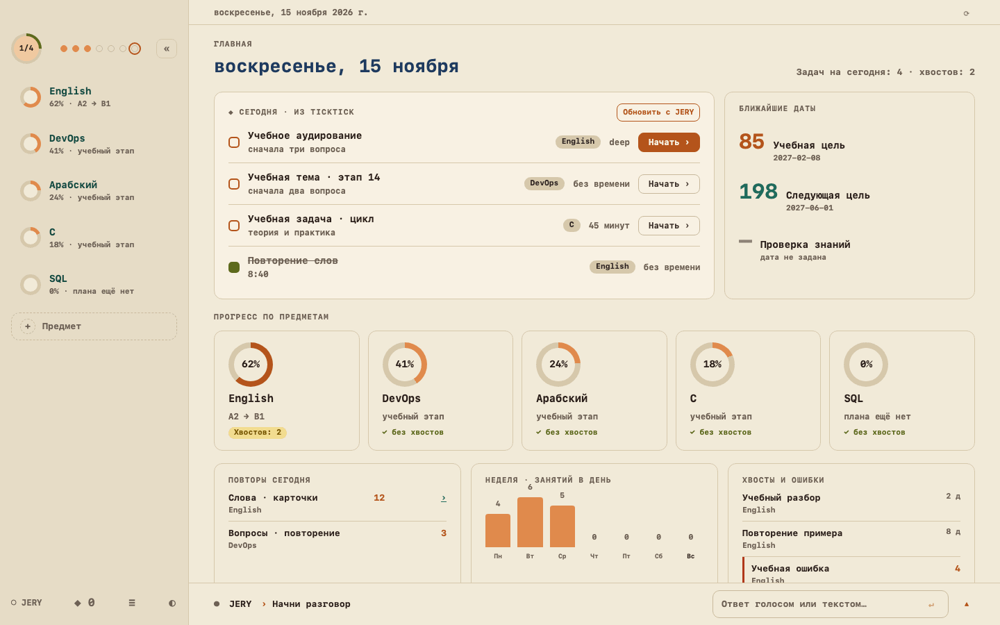

</div>

---

## Содержание

1. [Зачем Mellorin](#зачем-mellorin)
2. [Идея за минуту](#идея-за-минуту)
3. [Обзор приложения](#обзор-приложения)
4. [Как это работает](#как-это-работает)
5. [Требования](#требования)
6. [Быстрый старт](#быстрый-старт)
7. [Настройки](#настройки)
8. [Приватность и безопасность](#приватность-и-безопасность)
9. [Горячие клавиши](#горячие-клавиши)
10. [Статус и планы](#статус-и-планы)
11. [Вопросы и ответы](#вопросы-и-ответы)
12. [Карта документации](#карта-документации)
13. [Лицензия](#лицензия)

---

## Зачем Mellorin

Учиться с ИИ-ассистентом в терминале можно, но терминал плохо подходит для учёбы. Текст для чтения превращается в стену символов; тест по словам превращается в набранные вручную ответы «1б, 2г»; прогресс лежит в файлах, которые надо открывать; а каждая новая методика требует снова и снова просить ассистента вести себя иначе.

Mellorin сохраняет всё хорошее в таком подходе (сильный агент, ваши собственные заметки, никакой привязки) и заменяет терминал интерфейсом, который **создан для учёбы** и который **агент может перестраивать сам**:

- **Ваши данные остаются вашими.** Всё лежит в локальной папке с Markdown-файлами, той же, что открывает Obsidian. Удалите приложение, и ничего не потеряется.
- **Контент делает агент.** Он создаёт предметы, пишет уроки, добавляет слова, ведёт заметки и планы. Приложение контент не сочиняет.
- **Визуальную часть делает приложение.** Кликабельные слова и предложения, нумерация текста, кнопки вместо набранных ответов, скрытые транскрипты, которые открываются на нужном шаге, тропа прогресса, чтение конспектов.
- **Новым методикам не нужен новый код.** Скажите «ставь номер после каждого предложения», агент поменяет формат урока, а приложение его отрисует.

## Идея за минуту

Большинство программ поставляется с фиксированным интерфейсом. Mellorin поставляется с **небольшим строгим языком интерфейсов** и позволяет агенту писать на нём от вашего имени.

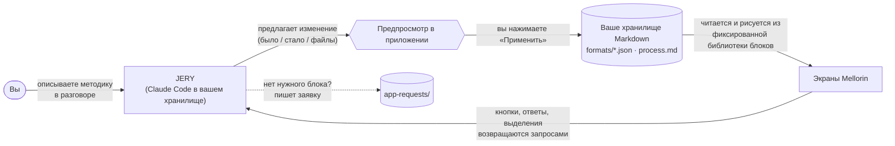

Четыре правила делают это безопасным и предсказуемым:

1. **Форматы это данные, а не код.** Формат урока: JSON-файл в вашем хранилище с шагами, а в каждом шаге список блоков. Без HTML, скриптов и выражений. Отрисовщик ничего не выполняет.
2. **Фиксированная библиотека блоков в три уровня.** Уровень 1: основа (заголовок, текст, список, таблица, карточка, колонки, прогресс, цитата, код). Уровень 2: умные блоки (текст с кликабельными словами, нумерация предложений, тест, карточки, аудиоплеер, поле для кода или запроса, таймер, чеклист, свёрнутые ответы). Уровень 3: **заявка**, если нужного блока ещё нет.
3. **Стиль задаёт приложение, а не агент.** Агент описывает смысл («это предупреждение»), а не цвета в hex и не размеры в пикселях. Всё, что он строит, выглядит родным.
4. **Ничего не меняется без вашего нажатия.** Изменение, предложенное агентом, показывается как предпросмотр с точным списком файлов; применяете его вы, оно сохраняется версией в `formats/.history/` и откатывается.

В итоге интерфейс растёт вместе с тем, как вы на самом деле учитесь, и ни вам, ни агенту не нужно писать код приложения.

## Обзор приложения

Все снимки ниже это настоящие кадры приложения на **синтетическом хранилище** (выдуманные данные), полученные скриптом `scripts/visual-qa.mjs`.

| | |
|---|---|
| 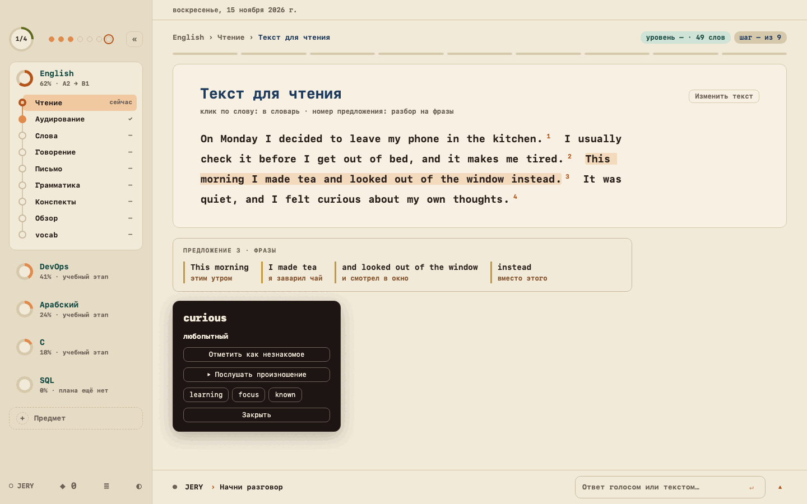 **Чтение.** Предложения с номерами, клик по предложению разбирает его на фразы, клик по слову даёт перевод, произношение и статус в словаре. | 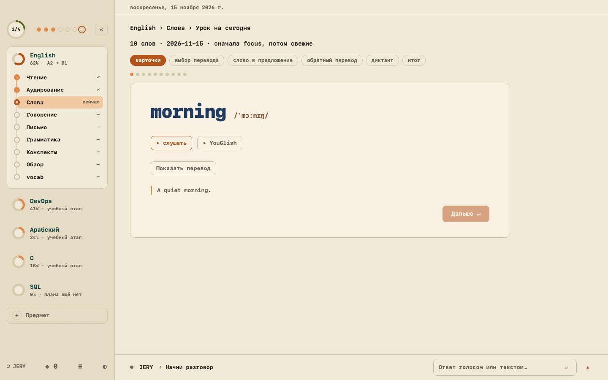 **Слова.** Урок из десяти слов с кнопками вместо набранных ответов, точками прогресса и дорожкой шагов. |
| 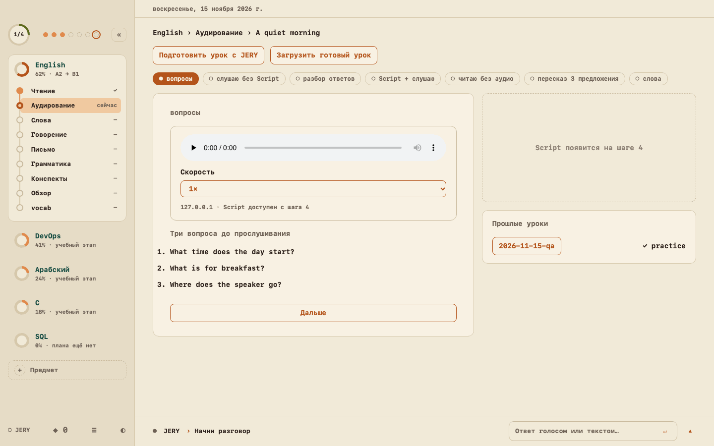 **Аудирование.** Вопросы до прослушивания, скрипт скрыт до шага, на котором он нужен. | 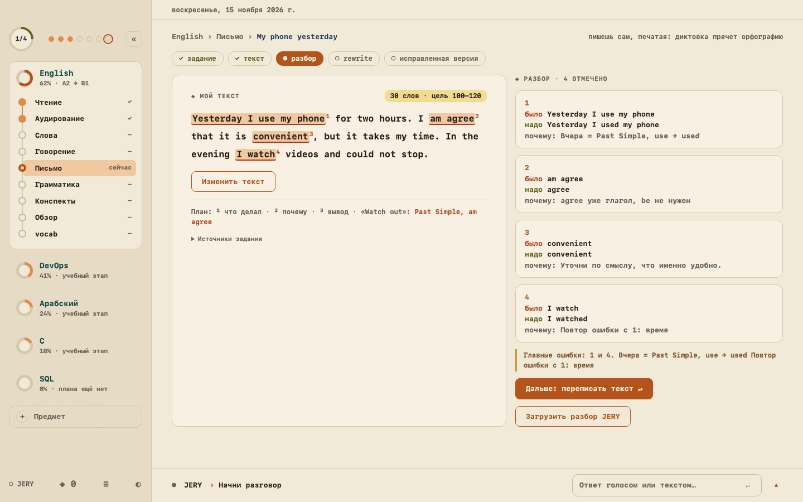 **Письмо.** Ваш текст с отмеченными ошибками, карточка разбора на каждое предложение, затем переписывание. |
| 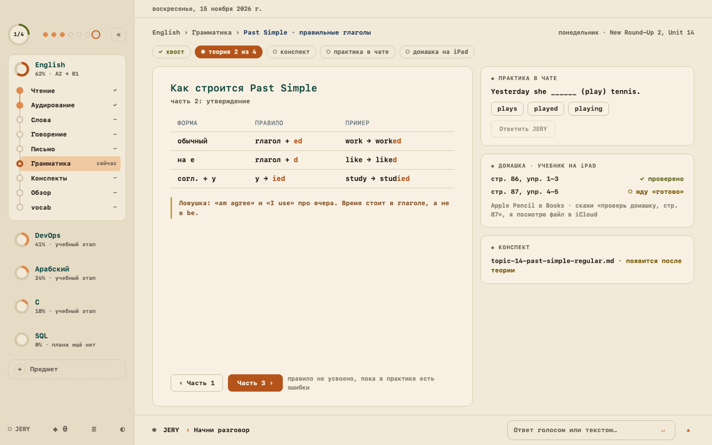 **Грамматика.** Теория по частям, формы в таблице, практика, учёт домашнего задания. | 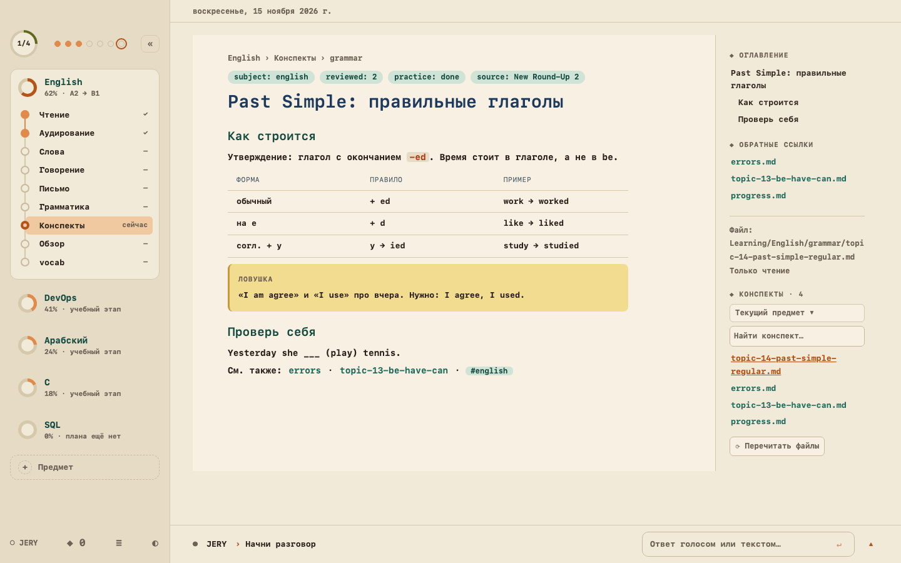 **Конспекты.** Ваши настоящие заметки в виде, как в Obsidian: свойства, заголовки, таблицы, выноски, ссылки `[[…]]`, оглавление. |
| 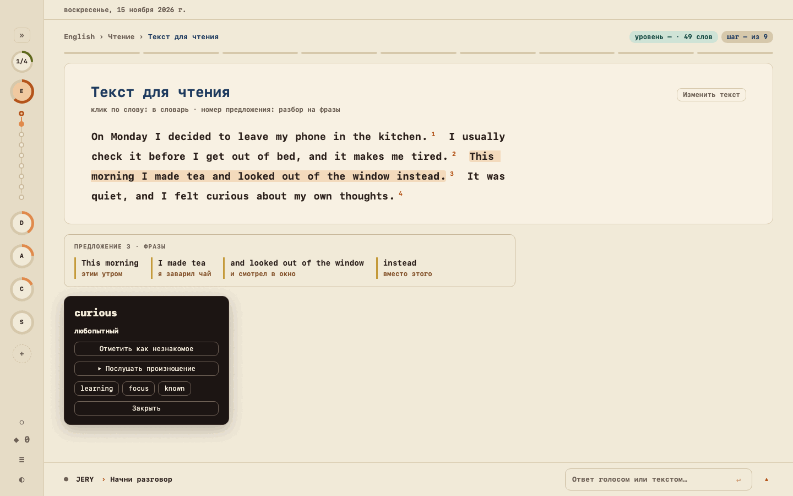 **Свёрнутая панель.** Тропа складывается в кольца с мини-тропой под активным предметом (⌘B). | 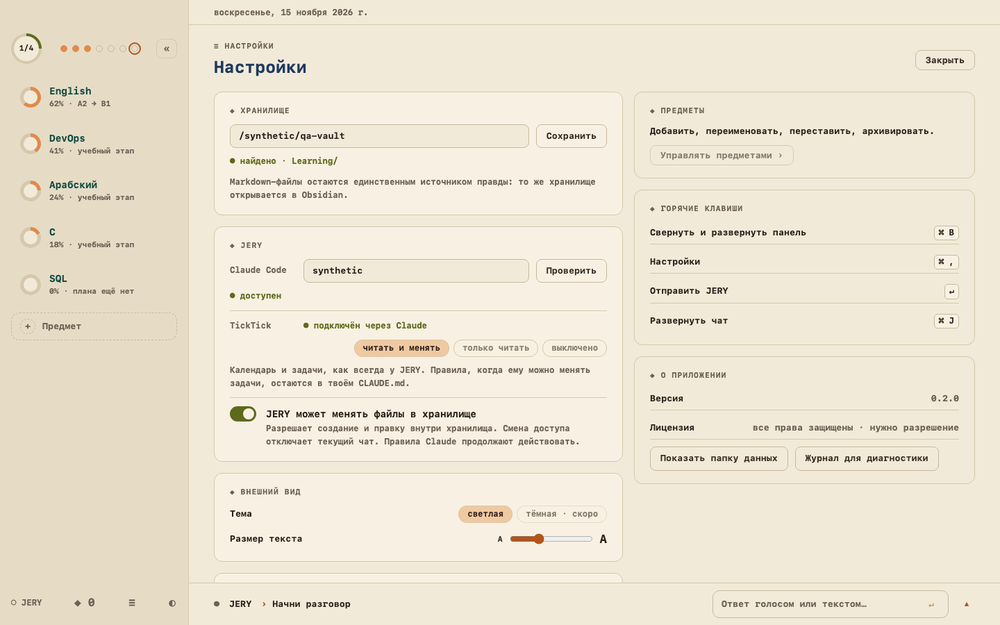 **Настройки.** Хранилище, Claude Code, что разрешено агенту, доступ к TickTick, история изменений с откатом. |

### Боковая панель: тропа, а не дерево

Сверху **кольцо дня** (сколько задач сегодня выполнено) и **точки недели**. Ниже открытый предмет это карточка с кольцом прогресса и **тропой** его видов занятий: пройденные узлы закрашены, текущий обведён, остальные пустые, линия оранжевая до последнего пройденного шага. Остальные предметы свёрнуты в строки. Названия приложения вверху нет: место занято состоянием, а не подписью.

### Строка агента

Нижняя строка всегда на виду: последнее сообщение агента в одну линию и поле ввода, которое работает с диктовкой macOS. Развернуть весь разговор можно по ⌘J. Когда агент думает, упёрся в лимит или прерван, строка это показывает и предлагает повторить.

## Как это работает

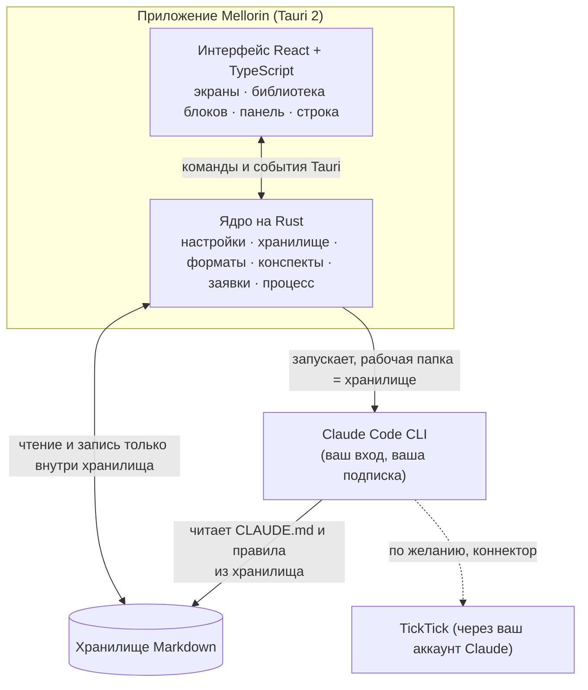

- **Агент это Claude Code, запущенный в вашем хранилище.** Mellorin не обращается к API моделей и не хранит ключей. Агент загружает *ваши* `CLAUDE.md` и правила, поэтому его характер и методики живут в ваших файлах, а не в приложении.
- **Приложение общается с агентом через потоковый JSON CLI** и показывает ответы по мере появления. В ответе могут быть блоки в ограждении `mellorin` (тест, таблица, набор карточек): приложение убирает из чата «сырой» JSON и рисует блоки.
- **Форматы уроков** это `formats/<предмет>-<вид>.json`. Изменение формата проходит путь: предложение `mellorin-change`, предпросмотр, явное «Применить», атомарная запись и снимок версии. См. [formats](docs/formats.md) и [протокол ответов](docs/jery-protocol.md).
- **Состояние для главной** (`.mellorin/state.json`, `today.json`) пишет агент по вашим реальным файлам; приложение только читает и показывает. Цифры не выдумываются.
- **TickTick** (задачи и календарь) доступен через коннектор в вашем аккаунте Claude, а не через учётные данные в Mellorin.

## Требования

- **macOS** на Apple Silicon (разработано и проверено там). Код кроссплатформенный (Tauri), но Windows и Linux в этом релизе не проверялись.
- **[Claude Code CLI](https://www.anthropic.com/claude-code)** установлен и выполнен вход. Mellorin использует вашу существующую подписку через CLI.
- *(По желанию)* включённый коннектор **TickTick** в аккаунте Claude, чтобы видеть задачи на сегодня и календарь.
- Папка с **Markdown-файлами** в роли хранилища: хранилище Obsidian подходит как есть. Для знакомства начните с *копии*.
- Для сборки из исходников: Node.js 20+, стабильный Rust и [требования Tauri 2](https://tauri.app/start/prerequisites/).

## Быстрый старт

Исходный код открыт для чтения; запускать его можно только с разрешения автора (см. [Лицензия](#лицензия)). С разрешением:

```bash
git clone https://github.com/Uzalov-Gamid/Mellorin.git
cd Mellorin
npm ci

# окно разработки с горячей перезагрузкой
npm run tauri -- dev

# или релизная сборка: приложение и .dmg появятся в src-tauri/target/release/bundle/
npm run tauri -- build
```

**Первый запуск**

1. Откройте Mellorin и нажмите <kbd>⌘</kbd><kbd>,</kbd>: откроются настройки.
2. Укажите **путь к хранилищу** (первые дни разумно работать с копией) и проверьте путь к **Claude Code**.
3. Решите, может ли агент менять файлы в хранилище (**включено** по умолчанию) и какой у него доступ к **TickTick**: *читать и менять*, *только читать* или *выключено*.
4. Выберите предмет в боковой панели и поговорите с агентом в нижней строке: *«давай почитаем текст»*, *«начни урок слов»*, *«что у меня сегодня?»*.

**Берегите данные.** Используйте скрипты в [`scripts/`](scripts/README.md): `vault-backup.sh` (проверенный снимок), `vault-diff.sh` (сравнение с оригиналом только для чтения), `vault-history.sh` (просмотр и откат изменений, если хранилище это git-репозиторий).

## Настройки

Настройки лежат в `mellorin.toml` в папке данных приложения (`~/Library/Application Support/dev.mellorin.app/` на macOS) и меняются на экране «Настройки».

| Ключ | По умолчанию | Значение |
|---|---|---|
| `vault_path` | `~/MellorinVault` | Папка, в которой работает агент и которую читает приложение |
| `claude_path` | `claude` | Путь к Claude Code CLI |
| `theme` | `light` | Тема (светлая кремовая палитра; тёмная запланирована) |
| `text_size` | `14` | Базовый размер текста |
| `jery_can_edit_vault` | `true` | Разрешить агенту создавать и менять файлы **внутри хранилища** |
| `jery_ticktick` | `full` | `full` (читать и менять), `read` или `off` |

Полный справочник: [docs/CONFIGURATION.md](docs/CONFIGURATION.md).

## Приватность и безопасность

- **Сначала локально.** Хранилище, состояние приложения и форматы это обычные файлы на вашем компьютере. Содержимое уходит только в процесс Claude Code, который вы запустили, под вашим аккаунтом.
- **Ключей в приложении нет.** Mellorin не хранит ключи API и учётные данные.
- **Правки только внутри хранилища.** При `jery_can_edit_vault` CLI работает в режиме `acceptEdits`: изменения файлов внутри хранилища разрешены; **команды, сеть и запись за пределами хранилища остаются запрещёнными**. Режимы обхода разрешений не используются.
- **Форматы инертны.** Это проверяемые данные со строгими пределами (256 КиБ, глубина 8, ограниченные размеры). Кода и путей для записи в них быть не может.
- **Изменения утверждаете вы.** Предложенное изменение формата показывается заранее и применяется только вашим нажатием, с историей, которую можно восстановить.
- **Служебные файлы не трогаются.** Приложение не перемещает и не правит ваши файлы `CLAUDE.md`, `.claude/`, `.obsidian/`, `JERY/`, `Templates/`; оно добавляет только `.mellorin/` и `formats/`.

Подробнее: [SECURITY.md](SECURITY.md) и [права на хранилище](docs/vault-permissions.md).

## Горячие клавиши

| Сочетание | Действие |
|---|---|
| <kbd>⌘</kbd><kbd>B</kbd> | Свернуть или развернуть боковую панель |
| <kbd>⌘</kbd><kbd>J</kbd> | Развернуть или свернуть разговор над строкой |
| <kbd>⌘</kbd><kbd>,</kbd> | Открыть или закрыть настройки |
| <kbd>↵</kbd> | Отправить агенту |
| <kbd>a</kbd> <kbd>b</kbd> <kbd>c</kbd> <kbd>d</kbd> (Слова) | Выбрать ответ; <kbd>↵</kbd> идёт дальше |

## Статус и планы

**Версия 0.2.0 это рабочий вертикальный срез**, собранный и проверенный на macOS (Apple Silicon): CI проверяет форматирование Rust, Clippy с запретом предупреждений, тесты Rust и типы с тестами фронтенда (116 тестов фронтенда в этом релизе). Сборка **без подписи и нотаризации**.

**Реализовано**

- Оболочка: окно без заголовка, тропа в боковой панели (сворачивается), кольцо дня и точки недели, строка агента с её состояниями.
- Экраны: Главная, Чтение английского, Слова, Аудирование, Письмо, Грамматика, чтение конспектов, Настройки (с историей изменений и откатом).
- Система форматов и блоков, протокол ответов `mellorin`, предложения `mellorin-change` с предпросмотром, применением и откатом, ящик заявок на блоки.
- Файлы состояния по вашим реальным заметкам, TickTick через аккаунт Claude, разрешение агенту на правки в хранилище с переключателем.
- Скрипты резервной копии, сравнения и истории.

**Спроектировано, макеты есть, ещё не сделано** (см. [макеты дизайна](docs/DESIGN.md)): экраны DevOps, арабского, C и SQL; менеджер словаря; управление предметами с архивом и восстановлением; окно «Новый текст»; боковые панели внешних источников (произношение и аудирование рядом с уроком); первый запуск; состояния ошибок и лимитов; итог занятия; календарь активности; «Мастерская» отдельным экраном.

**Запланировано:** тёмная тема, проверка на Windows и Linux, подписанные и нотаризованные сборки.

## Вопросы и ответы

**Mellorin отправляет мои заметки на сервер?**
Только в процесс Claude Code, который вы запускаете и который общается с Anthropic под вашим аккаунтом. У самого Mellorin нет сервера и аналитики.

**Нужен ли Obsidian?**
Нет. Хранилище это папка Markdown-файлов. Obsidian удобен для редактирования тех же файлов, но не обязателен.

**Можно попробовать, не рискуя заметками?**
Да, и стоит так сделать: скопируйте хранилище, направьте Mellorin на копию и используйте `scripts/vault-history.sh`, чтобы отменить любое изменение. Оригинал не затрагивается.

**А если агенту нужен элемент экрана, которого в приложении нет?**
Он пишет короткую заявку в `app-requests/`. Приложение показывает значок с числом открытых заявок. Затем новый блок добавляется в приложение.

**Почему язык блоков, а не код интерфейса от агента?**
Сгенерированный код может сделать что угодно, а сгенерированные *данные* могут только описывать. Ограничение агента проверенным словарём делает любое изменение видимым заранее, обратимым и безопасным для применения по нажатию.

**Можно ли использовать другого агента или модель?**
В этом релизе нет. Точка интеграции это Claude Code CLI; другие агенты возможны в будущем.

Больше в [docs/FAQ.md](docs/FAQ.md) (на английском).

## Карта документации

| Если вы хотите… | Читайте |
|---|---|
| Пользоваться приложением по шагам | [Руководство](docs/RU-GUIDE.md) |
| Найти настройку, файл или схему | [Настройки](docs/CONFIGURATION.md) · [Форматы](docs/formats.md) · [Протокол ответов](docs/jery-protocol.md) · [Схема состояния](docs/state.schema.json) |
| Понять устройство и дизайн | [Архитектура](docs/architecture.md) · [Макеты](docs/DESIGN.md) · [Глоссарий](docs/GLOSSARY.md) |
| Узнать, что разрешено агенту | [Права на хранилище](docs/vault-permissions.md) · [SECURITY.md](SECURITY.md) |
| Защитить хранилище | [scripts/](scripts/README.md) |
| Посмотреть, что менялось | [CHANGELOG](CHANGELOG.md) |

Индекс документации: [docs/README.md](docs/README.md).

## Лицензия

**Все права защищены.** Исходный код открыт для чтения на GitHub; использование, запуск, копирование, изменение или распространение требуют предварительного письменного разрешения [Гамида Узалова](https://github.com/Uzalov-Gamid). Это не открытая лицензия. Ранние версии, опубликованные под лицензией MIT (теги `mvp` и `v0.1.0`), остаются доступными на этих условиях. См. [LICENSE](LICENSE), [docs/LICENSING.md](docs/LICENSING.md) и [THIRD-PARTY-NOTICES](THIRD-PARTY-NOTICES).
